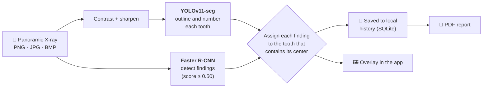
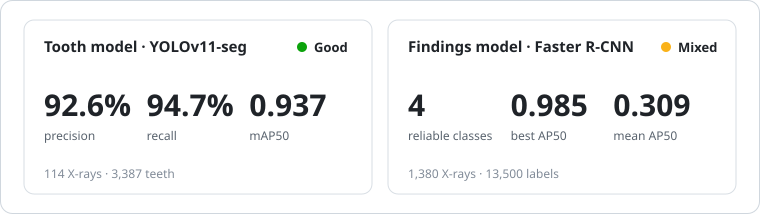
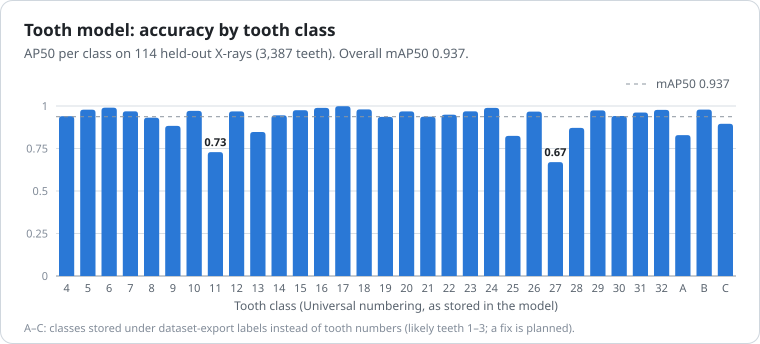
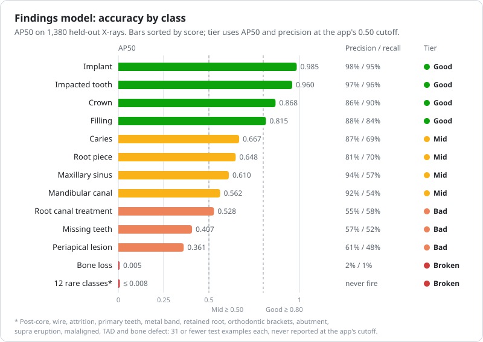
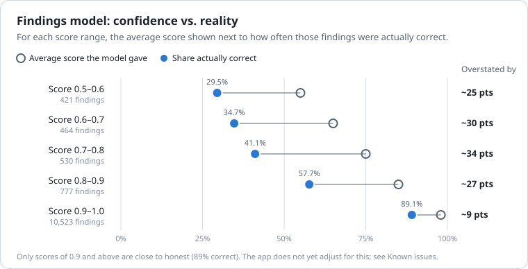
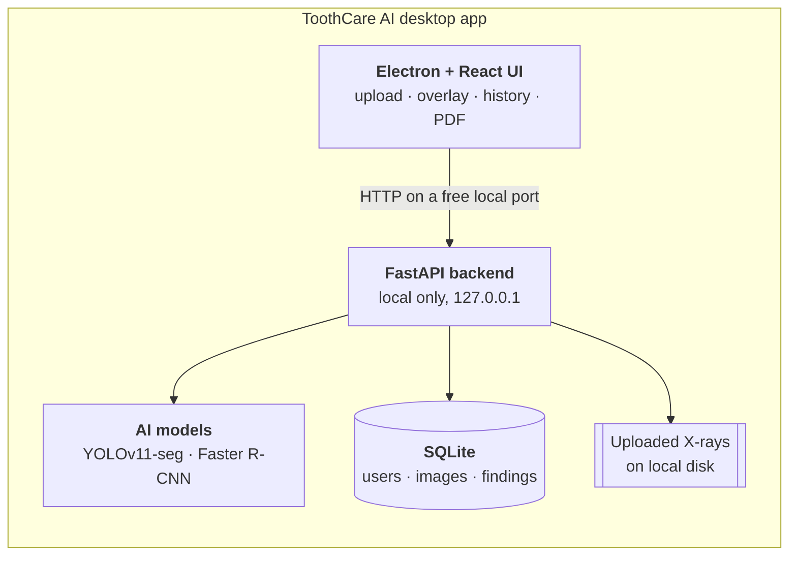

# ToothCare AI

**AI-assisted analysis of dental panoramic X-rays: a desktop app that runs 100% offline.**

Upload a panoramic X-ray. ToothCare AI outlines and numbers every tooth, detects restorations and conditions, links each finding to its tooth, and exports a PDF report. Nothing leaves your computer.

**[⬇ Download](#-download)** · **[How it works](#-how-it-works)** · **[Model performance](#-model-performance)** · **[Full evaluation](docs/MODEL_EVALUATION.md)**

> [!WARNING]
> **ToothCare AI is a research and educational prototype. It is not a medical device and does not diagnose.** Results are AI-generated suggestions that must be reviewed by a licensed dental professional. Read the [Medical Disclaimer](#%EF%B8%8F-medical-disclaimer) before use.

---

## ✨ Highlights

<table>
<tr>
<td width="50%" valign="top">

### 🔒 Private by design
The FastAPI backend and both AI models ship inside the installer. No cloud, no account server, no telemetry. X-rays and results never leave the machine.

</td>
<td width="50%" valign="top">

### 🦷 Two models, one result
**YOLOv11** segments and numbers each tooth. **Faster R-CNN** scans the whole X-ray for findings. Each finding is then attached to the tooth it sits on.

</td>
</tr>
<tr>
<td width="50%" valign="top">

### 📊 Evaluated, with honest numbers
Both models were scored on held-out data with the app's exact preprocessing and thresholds. Strong and weak classes are both [published below](#-model-performance).

</td>
<td width="50%" valign="top">

### 📄 Ready-to-share reports
Every analysis is saved to a searchable local history. One click exports a PDF with the X-ray and a structured list of findings.

</td>
</tr>
</table>

---

## 📑 Contents

- [How it works](#-how-it-works)
- [Features](#-features)
- [Model performance](#-model-performance)
- [What the app detects](#-what-the-app-detects)
- [Download](#-download) · [Installation](#-installation) · [System requirements](#%EF%B8%8F-system-requirements)
- [Architecture and tech stack](#%EF%B8%8F-architecture-and-tech-stack)
- [Known issues and roadmap](#%EF%B8%8F-known-issues-and-roadmap)
- [Medical disclaimer](#%EF%B8%8F-medical-disclaimer) · [Privacy policy](#-privacy-policy) · [Terms of use](#-terms-of-use)
- [Credits](#-credits) · [Support](#-support)

---

## 🔬 How it works

1. **Teeth.** The X-ray is contrast-enhanced and sharpened, then YOLOv11 draws an outline around every visible tooth and labels it with its number (Universal numbering, 1 to 32).
2. **Findings.** Faster R-CNN (ResNet-50 FPN v2) scans the original image for restorations, conditions and landmarks, and keeps detections scored 0.50 or higher.
3. **Assignment.** Each finding is attached to the one tooth whose box contains the finding's center and whose center is closest.
4. **Output.** The result is drawn over the X-ray, saved to your local history and available as a PDF.

---

## 🚀 Features

| | Feature | Description |
|---|---|---|
| 🦷 | **Tooth segmentation** | Outlines every visible tooth and labels it with its number. |
| 🔬 | **Finding detection** | Detects implants, crowns, fillings, impacted teeth, caries and more. See [what the app detects](#-what-the-app-detects). |
| 🗺 | **Findings linked to teeth** | Each finding is assigned to the tooth it belongs to. |
| 💾 | **Analysis history** | Every analysis is saved on your computer, searchable by date or condition, and can be deleted. |
| 📄 | **PDF reports** | One-click report with the X-ray and a structured list of findings. |
| 👤 | **Local accounts** | Each user has a password-protected account (Argon2 hashing) and their own history. |
| 🌗 | **Light and dark mode** | Switch themes at any time. |
| ✈️ | **Fully offline** | No internet connection is needed after installation. |

**Supported images:** dental panoramic X-rays in PNG, JPG/JPEG or BMP, up to 50 MB.

---

## 📈 Model performance

Both models were evaluated on **held-out labeled data that was not used for training**, with the same preprocessing, input size and score thresholds as the app.

| Metric | 🦷 YOLOv11-seg (teeth) | 🔬 Faster R-CNN (findings) |
| :--- | :---: | :---: |
| **Test data** | 114 X-rays · 3,387 teeth | 1,380 X-rays · 13,500 annotations |
| **Precision** at the app's cutoff | **92.6%** | 81.2% *(micro-average)* |
| **Recall** at the app's cutoff | **94.7%** | 76.5% *(micro-average)* |
| **F1** | **0.936** | 0.788 |
| **mAP50** | **0.937** (box and mask) | 0.309 *(mean over 24 classes)* |
| **mAP50-95** | 0.761 box · 0.651 mask | 0.183 |
| **Hallucinations** (nothing annotated nearby) | 1.5% of reported teeth | 5.2% of reported findings |
| **Speed** | ~13 ms per image | ~3 s per image |

> [!NOTE]
> All figures measure **agreement with public dataset labels**, not clinical accuracy. The findings model's micro-averaged precision and recall are dominated by its two most common classes (Filling and Impacted tooth); the class-averaged mAP50 of 0.309 is the fairer summary.

### 🦷 Tooth detection is reliable

92.6% of reported teeth are correct and 94.7% of annotated teeth are found. Every tooth class scores AP50 of 0.82 or higher except teeth 11 and 27.

### 🔬 Findings: strong on restorations, weaker on pathology

Four classes are reliable: **Implant, Impacted tooth, Crown and Filling**. Caries is usually right when reported (87% precision) but about one in three is missed. Bone Loss and the rare classes do not work yet.

| Tier | Criterion (at the app's 0.50 cutoff) |
| :--- | :--- |
| 🟢 **Good** | AP50 ≥ 0.80 and precision ≥ 80% |
| 🟡 **Mid** | AP50 0.50 to 0.80 and precision ≥ 60% |
| 🟠 **Bad** | AP50 < 0.50, or precision < 60% |
| 🔴 **Broken** | Never reported, or almost always wrong |

### 🎯 Read confidence scores with care

The findings model's scores run high. A finding scored 0.75 is correct about 41% of the time; only scores of 0.9 and above are close to honest. The tooth model's scores are honest or slightly cautious.

📘 **Full report:** methods, cutoff sweeps, error breakdowns, the non-dental image test and per-class tables are in **[docs/MODEL_EVALUATION.md](docs/MODEL_EVALUATION.md)**.

---

## 🔍 What the app detects

The findings model was trained on 32 classes. How reliable each one is on held-out data:

| Reliability | Classes | What it means for you |
| :--- | :--- | :--- |
| 🟢 **Reliable** | Implant · Impacted tooth · Crown · Filling | Usually correct and rarely missed. |
| 🟡 **Review closely** | Caries · Root piece · Maxillary sinus · Mandibular canal | Usually correct when shown, but 30–46% are missed. |
| 🟠 **Low reliability** | Root canal treatment · Missing teeth · Periapical lesion | Roughly half of these findings are wrong. Always confirm manually. |
| 🔴 **Not working yet** | Bone loss · and 12 rare classes¹ | Bone loss is almost always wrong; the rare classes are never reported. |
| ⚪ **Not scored** | Cyst · Fracture teeth · Dentals · Permanent teeth · Root resorption · Gingival former · Plating · Permanent retainer | No examples in the test data, so accuracy is unknown. |

¹ Post-core, wire, attrition, primary teeth, metal band, retained root, orthodontic brackets, abutment, supra eruption, malaligned, TAD (temporary anchorage device), bone defect. Each had 31 or fewer test examples.

### How to read the results

- **A score is not a probability.** Below 0.9, findings scores overstate how often the model is right (see the chart above).
- **Findings below 0.50 are hidden**, and findings that fall outside every detected tooth are not shown.
- **The models can miss findings and report findings that are not there.** Weaker classes, small lesions and low-quality or unusual X-rays make mistakes more likely.
- **Use only dental panoramic X-rays.** Periapical films, bitewings, CBCT slices and photos are not supported. The app does not yet reject them, and an ordinary photo can produce teeth and findings.

---

## 💾 Download

Get the installer from the **[latest release](../../releases/latest)**:

| Platform | File | Notes |
| :--- | :--- | :--- |
| 🪟 **Windows** | `ToothCareAI.Setup.1.0.0.exe` | 64-bit installer |
| 🍎 **macOS** | `ToothCareAI-1.0.0-arm64.dmg` | Apple Silicon (M1 or newer). Coming soon |

> 💡 No Python, Node.js or anything else is needed. The installer includes the backend and both AI models.

## 🧩 Installation

<b>🪟 Windows</b>

1. Run `ToothCareAI.Setup.1.0.0.exe`.
2. If Windows SmartScreen shows **"Windows protected your PC"**, click **More info → Run anyway**. This appears because the app is not code-signed yet.
3. Follow the installer, then open **ToothCareAI** from the Start menu.

<b>🍎 macOS</b>

1. Open `ToothCareAI-1.0.0-arm64.dmg` and drag **ToothCareAI** into **Applications**.
2. The app is not notarized by Apple yet, so macOS may block it the first time. To allow it, either:
   - right-click the app → **Open** → **Open**, or
   - go to **System Settings → Privacy & Security** and click **Open Anyway**.

> ⏱ The first analysis takes a few extra seconds while the AI models load into memory.

## ⚙️ System requirements

| Component | Minimum | Recommended |
| :--- | :--- | :--- |
| 🪟 **Windows** | Windows 10, 64-bit | Windows 11, 64-bit |
| 🍎 **macOS** | macOS 12 Monterey, Apple Silicon (M1) | Latest macOS, M2 or newer |
| 🧠 **Processor** | 64-bit, 4 cores | 8 or more cores |
| 💾 **RAM** | 4 GB | 8 GB or more |
| 💽 **Disk space** | 2 GB free | 4 GB or more (for saved X-rays) |
| 🖥 **Display** | 1280 × 720 | 1920 × 1080 or higher |
| 🌐 **Internet** | Not required | Not required |

> ℹ️ Analysis runs on the CPU; no graphics card is needed. Intel Macs are not supported yet.

---

## 🏗️ Architecture and tech stack

When the app starts, Electron launches the bundled backend on a free local port, waits for its health check, then loads the interface. The backend is closed when the window closes.

| Layer | Technology |
| :--- | :--- |
| **Desktop shell** | Electron 39, electron-builder (NSIS for Windows, DMG for macOS) |
| **Interface** | React 19, TypeScript 5.9, Vite 7 |
| **Backend** | FastAPI, Uvicorn, SQLAlchemy 2.0, Alembic migrations, SQLite |
| **Security** | Argon2 password hashing, expiring session tokens, login lockout after repeated failures |
| **AI** | Ultralytics YOLO11 segmentation (2.85 M parameters, 6 MB) · torchvision Faster R-CNN ResNet-50 FPN v2 (43.4 M parameters, 348 MB) |
| **Reports** | fpdf2 |
| **Packaging** | PyInstaller (backend) bundled into the Electron installer |
| **Testing** | 63 backend tests (pytest) · 28 frontend tests (Vitest + React Testing Library) |

---

## 🛠️ Known issues and roadmap

The evaluation found issues that users see directly. They are **open** in v1.0.0 and planned first:

- [ ] **Hide unreliable findings.** Show only Good and Mid classes; hide Bone loss and classes that never fire.
- [ ] **Fix confidence display.** Stop showing raw scores as percentages, or calibrate them per class.
- [ ] **Reject non-dental images.** Check that an upload looks like a panoramic X-ray before analysis.
- [ ] **Fix three tooth labels.** Three tooth classes carry dataset-export names instead of numbers (likely teeth 1–3).

Later:

- [ ] Reduce false Root canal treatment findings (37% of all false findings) with a per-class threshold.
- [ ] Merge duplicate tooth boxes (class-agnostic NMS).
- [ ] Confidence intervals for all reported metrics.
- [ ] Validation on full-size X-rays from other clinics, healthy X-rays, and labels reviewed by a dental professional.
- [ ] Signed Windows installer and notarized macOS app.

---

## ⚕️ Medical disclaimer

**ToothCare AI is not a medical device.** It has not been cleared or approved by the U.S. Food and Drug Administration (FDA) or any other regulatory body, and it has not been clinically validated. It is a research and educational prototype built as a capstone project.

- ToothCare AI **does not provide a medical or dental diagnosis**, and it does not replace examination, diagnosis or treatment by a licensed dental professional.
- Every result is a computer-generated suggestion that **must be reviewed and confirmed by a qualified professional** before any clinical decision is made.
- The AI models can produce **false positives** (reporting a condition that is not present) and **false negatives** (missing a condition that is present). See [Model performance](#-model-performance).
- Do **not** start, change or stop any treatment based only on this software's output.
- **If you are a patient**, do not use ToothCare AI to diagnose yourself. Talk to your dentist about any concerns about your oral health.
- **In an emergency**, contact a dental or medical professional or your local emergency services right away.

---

## 🔒 Privacy policy

<i>Effective date: October 23, 2026.</i> In short: everything stays on your computer. Click to read the full policy.

 

**1. Data stays on your computer.** All analysis happens locally. ToothCare AI **does not send** your X-rays, results, reports or account details to any server, cloud service or third party. The app works without an internet connection.

**2. What the app stores.** The app saves the following on your computer only:

| Data | Purpose |
| :--- | :--- |
| Name, email and password (stored as a secure Argon2 hash, never as plain text) | To sign in to your local account |
| X-ray images you upload | To show your analysis history and build PDF reports |
| Analysis results (findings, confidence scores, dates) | To show your history |
| Technical logs | To troubleshoot problems |

**3. Where data is stored.**
- **Windows:** in the app's install folder, for example `%LOCALAPPDATA%\Programs\toothcareai\data\`
- **macOS:** `~/Library/Application Support/toothcareai/`

**4. No tracking.** ToothCare AI has no analytics, telemetry, advertising or tracking of any kind.

**5. Your control.** You can delete any analysis from the History page. Uninstalling the app and deleting the folders above removes all of your data. Exported PDF reports are saved wherever you choose, and you are responsible for them.

**6. Your responsibility for patient data.** If you analyze X-rays of other people, you are responsible for getting their consent and for following the privacy laws that apply to you, such as HIPAA (U.S.) or GDPR (EU). This includes securing the computer the app runs on. We recommend removing names and other identifying details from images before you analyze them.

**7. Children.** ToothCare AI is not meant to be used by children under 13 on their own.

**8. Changes.** We may update this policy. Changes will be posted in this repository with a new effective date.

---

## 📜 Terms of use

<i>Effective date: October 23, 2026.</i> Free for personal, educational and research use; provided as is. Click to read the full terms.

 

By downloading, installing or using ToothCare AI ("the Software"), you agree to these Terms. If you do not agree, do not use the Software.

**1. License.** You may download and use the Software free of charge for personal, educational, research and professional decision-support purposes. All rights not expressly granted are reserved by the author.

**2. Restrictions.** You may not:
- sell, rent, sublicense or redistribute the Software, or offer it as a paid service, without written permission;
- reverse engineer, decompile or extract the AI models from the Software, except where the law allows it;
- remove or change any copyright notice, disclaimer or attribution;
- present the Software as a certified medical device, or use it as the only basis for a diagnosis or treatment decision.

**3. Not medical advice.** The Software is a decision-support tool, not a medical device. All output must be reviewed by a qualified professional. See the [Medical disclaimer](#%EF%B8%8F-medical-disclaimer).

**4. Your responsibilities.** You are responsible for:
- how you use the Software and any decisions you make based on its results;
- having the right to use any images you upload;
- following the laws and professional rules that apply to you, including patient privacy and consent;
- keeping your computer, account password and data secure, and keeping backups.

**5. No warranty.** The Software is provided **"as is" and "as available," without warranties of any kind**, express or implied. This includes warranties of accuracy, reliability, merchantability, fitness for a particular purpose and non-infringement. The author does not guarantee that the Software will be error-free or that its results will be correct or complete.

**6. Limitation of liability.** To the maximum extent permitted by law, the author is **not liable** for any direct, indirect, incidental, special or consequential damages arising from the use of, or inability to use, the Software. This includes misdiagnosis, missed findings, treatment decisions, data loss and harm to patients.

**7. Third-party components.** The Software includes open-source components and was trained on third-party data, each under its own license. See [Credits](#-credits).

**8. Updates and termination.** The Software may be updated, changed or discontinued at any time. Your right to use it ends automatically if you break these Terms.

**9. Changes to these Terms.** We may update these Terms. Continuing to use the Software after changes are posted means you accept them.

---

## 🙏 Credits

- **Tooth segmentation data:** Roboflow "manmax" v3, which points to the [Dental dataset by salud360 on Roboflow Universe](https://universe.roboflow.com/salud360/dental-qbbud), licensed under [CC BY 4.0](https://creativecommons.org/licenses/by/4.0/).
- **Findings data:** "Dental X-Ray Panoramic Dataset" v2 on Roboflow Universe.
- **Open-source software:** [Ultralytics YOLO](https://github.com/ultralytics/ultralytics), [PyTorch](https://pytorch.org/) and [torchvision](https://github.com/pytorch/vision), [FastAPI](https://fastapi.tiangolo.com/), [SQLAlchemy](https://www.sqlalchemy.org/), [Electron](https://www.electronjs.org/), [React](https://react.dev/) and [fpdf2](https://github.com/py-pdf/fpdf2).

## 💬 Support

Found a bug or have a question? Open an issue on the **[Issues](../../issues)** page with your operating system, app version and a description of the problem.

> [!CAUTION]
> **Never attach real patient X-rays or personal information to an issue.** Issues are public.

---

Built by **Luis Arzuaga** and **Angel Fonseca** as a capstone project · © 2026 Luis Arzuaga. All rights reserved.

